# SciLab Design Document

**Product:** SciLab Spectrometer Characterization System
**Version described:** v3.4.4.0 (released 2026-10-09)
**Document date:** 2026-10-12
**Maintainer:** Ashutosh Joshi, SciGlob. Prepared with Claude Code from the source tree, the test-suite and the bench notes in `docs/`.

This document describes how SciLab is built: what it does, how the code is layered, how the threads, hardware adapters, measurement sequence, analysis pipeline, persistence and packaging fit together, and where the known limits are. Every diagram is drawn from the code in this checkout. Figures marked *measured* were produced by running the real code (`docs/figures/make_figures.py`); figures marked *quoted* chart numbers recorded in `README.md` and `CHANGELOG.md`.

Related documents: [`README.md`](../README.md) (operator and developer setup), [`CHANGELOG.md`](../CHANGELOG.md) (release history), [`system-design-document.md`](system-design-document.md) (the April and September 2026 refactor notes this document supersedes), [`packaging/README.md`](../packaging/README.md), and the three hardware studies [`hama6-c13016-integration-guide.md`](hama6-c13016-integration-guide.md), [`flame-s-oceandirect-integration-guide.md`](flame-s-oceandirect-integration-guide.md) and [`jeti-pe60-2-integration-guide.md`](jeti-pe60-2-integration-guide.md).

---

## Contents

1. [Purpose and scope](#1-purpose-and-scope)
2. [System overview](#2-system-overview)
3. [Architecture](#3-architecture)
4. [Runtime model: threads, the UI pump and device ownership](#4-runtime-model-threads-the-ui-pump-and-device-ownership)
5. [Startup](#5-startup)
6. [Spectrometer backends: contract, discovery and connection](#6-spectrometer-backends-contract-discovery-and-connection)
7. [Light sources, head sensor and stage](#7-light-sources-head-sensor-and-stage)
8. [The measurement run](#8-the-measurement-run)
9. [Data model and persistence](#9-data-model-and-persistence)
10. [Analysis pipeline](#10-analysis-pipeline)
11. [User interface](#11-user-interface)
12. [Packaging, installation and self-test](#12-packaging-installation-and-self-test)
13. [Testing strategy](#13-testing-strategy)
14. [Performance](#14-performance)
15. [Failure handling and safety](#15-failure-handling-and-safety)
16. [Known limitations](#16-known-limitations)
17. [Roadmap](#17-roadmap)
- [Appendix A: Figures and how to regenerate them](#appendix-a-figures-and-how-to-regenerate-them)
- [Appendix B: Glossary](#appendix-b-glossary)

---

## 1. Purpose and scope

SciLab is a Windows desktop application that characterizes a spectrometer on an optical bench. An operator connects a spectrometer, switches lasers and a mercury-argon lamp on and off, watches live spectra, runs an automated multi-source measurement with auto-exposure, and gets the line-spread functions, dispersion polynomial, slit-function parameters and spectral-resolution curve of the instrument as plots and a metrics file.

The document covers the whole application: entry point, Tk shell, tabs, services, domain contracts, analysis, hardware adapters, vendor backends, build and installer. It does not repeat the per-instrument bench studies in `docs/`; it links to them.

## 2. System overview

### 2.1 Context

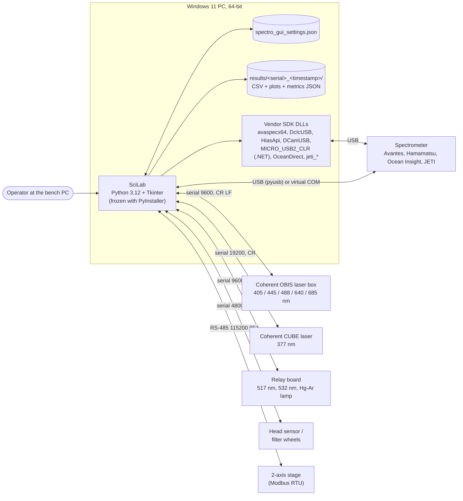

### 2.2 The operator workflow

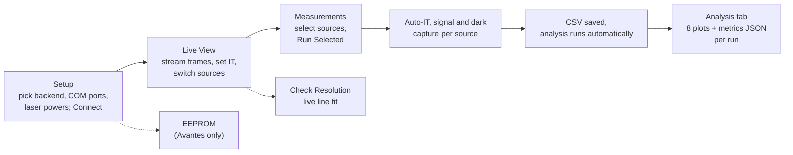

### 2.3 Key facts

| Item | Value |
| --- | --- |
| Language and UI toolkit | Python 3.12, Tkinter/ttk, matplotlib (TkAgg), numpy, scipy, pandas, Pillow, pyserial, pymodbus, pyusb, pythonnet |
| Target platform | Windows 10/11 x64 (the vendor DLLs are 64-bit only); the source tree also runs on macOS/Linux with the Simulated backend |
| Spectrometer backends | Ava1, Hama2, Hama3, Hama4, Hama5, Hama6, MiniSpec, OcOpt1, Jeti1, Simulated (10) |
| Light sources | Up to 9 tags: 377, 405, 445, 488, 517, 532, 640, 685 nm and the Hg-Ar lamp, each routed to one of three serial controllers |
| Deliverable | `SciLab-Setup-<version>.exe`, an Inno Setup installer around a one-folder PyInstaller bundle |
| Single source of version truth | `scilab_version.py` (`VERSION_TUPLE = (3, 4, 4, 0)`) |
| Automated tests | 187 pytest cases (177 without a display, 10 Tk smoke tests) |
| Code size | about 32,000 lines of Python, 43 % of it vendor backends (see Figure 1) |

## 3. Architecture

### 3.1 Layers

SciLab is a single-process desktop application with explicit internal seams. The UI drives the application, but workflow and science live in services, domain and analysis modules that do not import Tk.

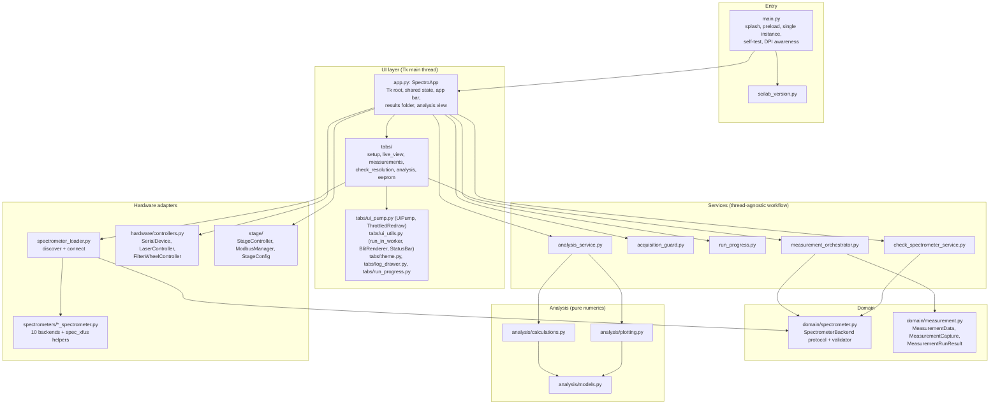

### 3.2 Module responsibilities

| Module | Responsibility | Depends on |
| --- | --- | --- |
| `main.py` | Startup order (splash first, imports behind it, window built out of sight), single-instance mutex, DPI awareness, `--self-test`, `--version`, background preload of the analysis stack | `app`, `scilab_version` |
| `app.py` (`SpectroApp`) | Tk root; shared state (`spec`, `data`, `lasers`, `run_progress`, `lit_sources`); app bar with instrument, lit-source and run chips; tab notebook with lazy build and warm-up; results directory; analysis run and preview tabs; Check Spectrometer launcher; tunables (targets, IT limits, cycle counts) | UI infra, services, domain, hardware |
| `tabs/setup_tab.py` | Backend and DLL selection, COM ports, laser table and powers, stage config, Advanced bench options, Connect/Disconnect, settings load and save, `on_close` | `spectrometer_loader`, `run_in_worker` |
| `tabs/live_view_tab.py` | Acquisition thread for live frames, deferred IT changes, blitted plot, readout card, source checkboxes | `BlitRenderer`, `ThrottledRedraw` |
| `tabs/measurements_tab.py` | Source selection, presets, target band, reference CSVs, Run/Stop, builds the orchestrator and its callbacks, countdown modal, measurement plot | `services.measurement_orchestrator`, `RunProgressPanel` |
| `tabs/check_resolution_tab.py` | Streams frames and fits the brightest line with the Check Spectrometer model on every frame; live readouts | `check_spectrometer_service._fit_peak` |
| `tabs/analysis_tab.py` | Analysis notebook: welcome card, run tabs with PNG previews and summary text, export and open-folder actions | `app.refresh_analysis_view` |
| `tabs/eeprom_tab.py` | Read and write the Avantes EEPROM (serial, detector, defective pixels, gain/offset) | Ava1 backend only |
| `tabs/ui_pump.py` | `UiPump`: one queue drained on the Tk thread; `ThrottledRedraw`: newest-frame-wins rendering | Tk-free, unit tested |
| `tabs/ui_utils.py` | `run_in_worker` (hardware I/O off the Tk thread under one lock), `BlitRenderer`, `StatusBar`, `Tooltip`, `ScrollableFrame`, debounced configure | Tk |
| `tabs/theme.py` | Colours, fonts, DPI-aware scaling (`Fonts.SCALE`, `logical_px`), ttk styles, matplotlib styling, source colours | Tk, matplotlib |
| `tabs/log_drawer.py` | Root-logger handler that marshals records through the pump into a collapsible, colour-tagged log view | `UiPump` |
| `tabs/run_progress.py` | `RunProgressPanel` (per-source checklist) and `RunChip` (app-bar chip) reading `RunProgress` snapshots | `services.run_progress` |
| `services/measurement_orchestrator.py` | The measurement sequence: source switching, auto-IT, signal and dark capture, 640 nm ladder, Hg-Ar countdown, bench options, progress callbacks | `domain`, laser controller duck type |
| `services/acquisition_guard.py` | Single-owner token for the spectrometer handle | `threading` |
| `services/run_progress.py` | Thread-safe model of a run: per-source state, IT, peak, frames, timing | `threading` |
| `services/analysis_service.py` | Compute, render, persist `metrics_<sn>_<ts>.json`; caches reference CSVs by path and mtime | `analysis/*` |
| `services/check_spectrometer_service.py` | Auto-IT to 60 % full scale, 3 s lamp frame, blind-pixel dark correction, modified-Gaussian fit, plot and data dump | scipy |
| `domain/spectrometer.py` | `SpectrometerBackend` protocol, required attributes and methods, `assert_spectrometer_backend` | none |
| `domain/measurement.py` | Row-oriented capture table, `to_dataframe()` (lazy pandas), `last_vectors_for()` | numpy |
| `analysis/calculations.py` | `compute_characterization`: LSFs, Hg-Ar peak matching, SDF matrix, dispersion fit, slit-function fits, resolution curve | numpy, scipy, pandas |
| `analysis/plotting.py` | Renders the computation into PNG artifacts at 150 dpi | matplotlib (Agg figures) |
| `analysis/models.py` | `CharacterizationConfig` and the typed result dataclasses | numpy |
| `spectrometer_loader.py` | Type normalisation, DLL path inference, Auto probe order, USB vendor pre-scan, discovery, connection, contract validation | backends |
| `spectrometers/*` | One module per vendor family; `spec_xfus.py` shared helpers (`calc_msl`, `split_cycles`, `measurement_timeout_s`, `SpecClock`); `_winapi.py` shim so drivers import off Windows | ctypes, pyusb, pythonnet, vendor SDKs |
| `hardware/controllers.py` | `SerialDevice` (open, framed or timed replies, retries), `LaserController` (OBIS, CUBE, RELAY, `all_off`), `FilterWheelController` | pyserial |
| `stage/*` | Modbus RTU motor control, config reader, safe three-step slot move | pymodbus |
| `packaging/*` | `build.py` (version resource, icon, PyInstaller, self-test, Inno Setup), `SciLab.spec`, `installer.iss` | PyInstaller, ISCC |
| `tools/*` | Bench diagnostics and smoke tests for C13016, Hamamatsu drivers, OceanDirect, JETI | backends |

### 3.3 Dependency rules

- **`services/`, `domain/`, `analysis/` never import Tk.** They are exercised by tests without a display, and the orchestrator runs end-to-end against the simulator in the test-suite.
- **Only the Tk main thread touches widgets.** Worker threads post callables through `UiPump.post`; `run_in_worker` wraps the common case.
- **Backends are reached only through the loader and the contract.** The rest of the application reads `rcm`, `rcs`, `sn`, `npix_active`, `it_ms`, `eff_saturation_limit` and calls `connect`, `disconnect`, `set_it`, `measure`, `wait_for_measurement`, `abort`, `request_stop`.
- **Startup imports are bounded.** `app.py` and the eager tabs must not import pandas or scipy; a test (`test_startup_imports.py`) guards this. The analysis stack is imported later on a worker thread.
- **Backends are imported by name through `importlib`,** so the PyInstaller spec lists them as hidden imports and the self-test imports every one.

### 3.4 Code composition

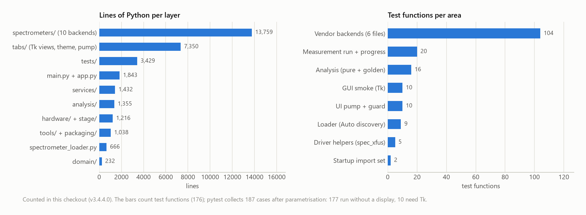

*Figure 1 (measured). The vendor backends are the largest body of code by far; the domain contract they all satisfy is the smallest. On the right, the test-suite weights the same way: the newest backends (Hama6, Jeti1, OcOpt1, Hama5) carry most of the tests because they were written test-first against fake SDKs.*

## 4. Runtime model: threads, the UI pump and device ownership

### 4.1 Threads and the one way back to Tk

Every long operation runs on a daemon thread. The only route from a worker back to the UI is `UiPump.post(fn, *args)`: the pump drains its queue on the Tk thread every 15 ms, spending at most 8 ms per tick so input stays responsive. `ThrottledRedraw` sits on the pump for frame data: acquisition threads submit frames as fast as they arrive, only the newest is kept, and it is rendered once per tick and drawn only while its tab is visible.

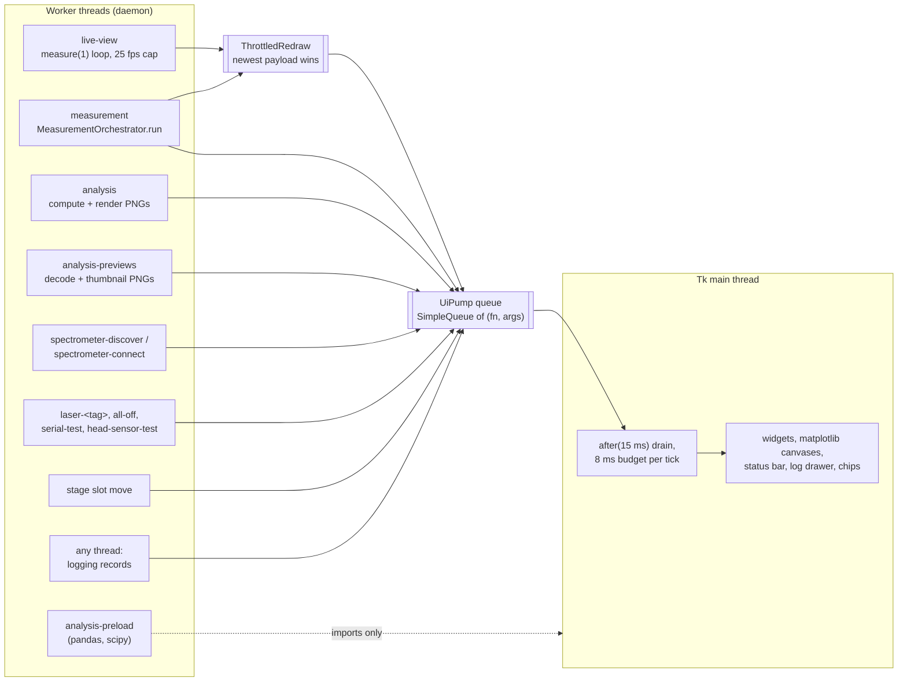

| Thread | Started by | Ends when | Talks to hardware |
| --- | --- | --- | --- |
| Tk main thread | `main.py` | window closed | never blocks on hardware |
| `live-view` | Live View Start | Stop, error, or disconnect | spectrometer |
| measurement worker | Run Selected | run finishes or Stop | spectrometer and lasers |
| `analysis` | Analyse last run, or automatically after a run | plots rendered | none |
| `analysis-previews` | each new run tab | thumbnails decoded | none |
| `spectrometer-discover`, `spectrometer-connect` | Connect | enumeration or connection done | spectrometer DLLs and USB |
| `laser-<tag>`, `all-off`, `serial-test`, `head-sensor-test`, `stage-test` | checkboxes, All off, Setup test buttons | reply received | serial ports (one shared hardware I/O lock) |
| stage move | Go to slot | move done, alarm or 60 s timeout | Modbus RTU |
| `analysis-preload` | 2 s after the window appears | imports done | none |
| `check-spectrometer` | Check spectrometer button | routine done | spectrometer |
| backend internal threads | each driver | per driver | vendor SDK (Hama6 runs every DLL call on one worker with a 15 s watchdog; MiniSpec owns a lifecycle thread with a Win32 message pump) |

### 4.2 Ownership of the spectrometer handle

Live View, Measurements, Check Resolution, Check Spectrometer, Apply IT and the EEPROM tools all drive the same device. `AcquisitionGuard` is a single-owner token: a Start button claims it on the Tk thread with a label, the worker releases it when its last frame completes, and any other Start is refused with a consistent "X is running. Stop it first." message. The owner is a label rather than a thread, which is why a plain lock around the label is used instead of an `RLock`.

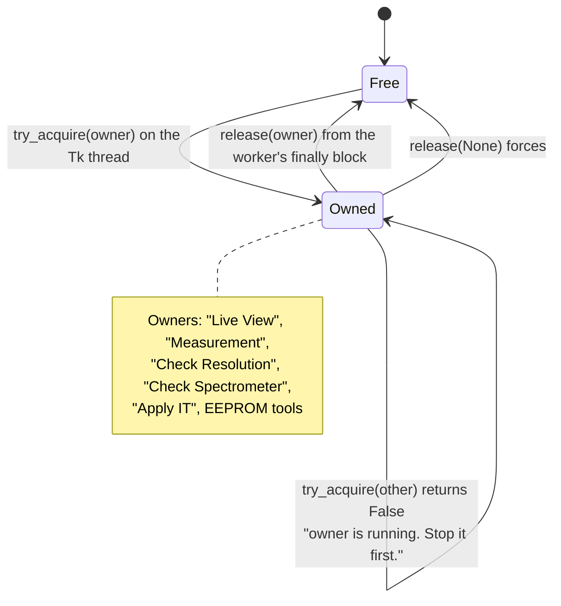

Stop is immediate: `SpectroApp.request_spectrometer_stop` calls the backend's `request_stop()`, which aborts the device and wakes any thread blocked in `wait_for_measurement`. Every backend's `wait_for_measurement(timeout=None)` defaults the timeout to twice the expected duration plus a margin, so a dead vendor thread can no longer hang the application.

## 5. Startup

The startup order is tuned for perceived speed: a tiny Tk root with the logo appears within about 100 ms; numpy, matplotlib and the eager tab modules import while it is on screen; the main window is built withdrawn and shown once, maximised and complete; the splash closes only then. pandas and scipy are not needed by anything visible, so they are imported on a daemon thread two seconds after the window is up.

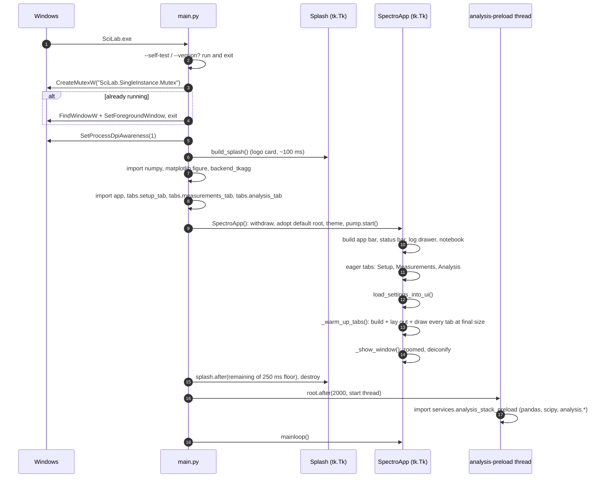

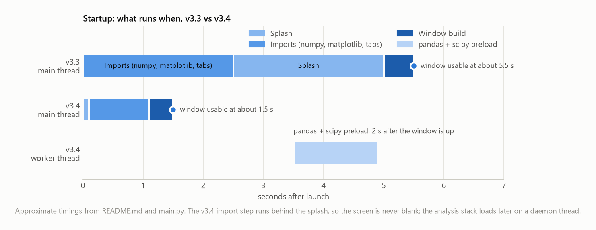

*Figure 2 (quoted). In v3.3 the imports ran before anything was drawn and were followed by a fixed 2.5 s splash. In v3.4 the import step runs behind the splash and the window is usable about 1.5 s after launch; the heavier analysis imports are moved off the startup path altogether.*

Other startup facts:

- **Single instance.** Two copies would both try to open the same USB spectrometer and the second one's failure would look like broken hardware. The mutex name is shared with the installer's `AppMutex`, so Setup refuses to overwrite a running installation.
- **Default root.** Tkinter binds master-less variables, images and standard dialogs to the first `tk.Tk`, which would be the splash. `SpectroApp._adopt_default_root` points the default at the main window so they survive the splash's destruction.
- **Warm-up.** Every tab is built, laid out and drawn at its final size while the window is still withdrawn, so a tab switch later is only a switch (previously the first visit to Live View, Check Resolution or EEPROM built the tab and paid a full-size matplotlib draw).
- **Self-test.** `SciLab.exe --self-test` imports every dependency and every backend, checks the vendor DLL folder, the writable data directory and the bundled assets, prints a report and writes `self-test.log`. The build, the installer and a Start-menu shortcut all run it (see section 12).

## 6. Spectrometer backends: contract, discovery and connection

### 6.1 The contract

Every backend is duck-typed against `SpectrometerBackend`. The loader validates an instance before handing it to the application, so a new backend that drifts from the shape fails early with a readable `TypeError` rather than an `AttributeError` mid-run.

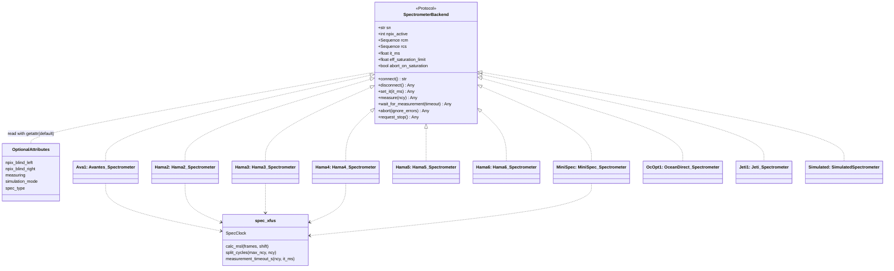

Conventions shared by every backend:

- `connect`, `set_it`, `measure`, `wait_for_measurement` and `abort` return the string `"OK"` on success or an error description.
- `measure(ncy)` is non-blocking; `wait_for_measurement(timeout)` blocks until the cycles are done. Afterwards `rcm` holds the mean counts and `rcs` the per-pixel standard deviation.
- `request_stop()` is what Stop calls: it aborts the device and wakes any waiting thread promptly.
- The application sets `abort_on_saturation = False` after connecting so saturated frames reach the UI, where they are clamped and flagged.

### 6.2 Backend matrix

| Type | Instruments | Binding | Vendor library | Shipped in the installer | Validation state (per `README.md` and `CHANGELOG.md`) |
| --- | --- | --- | --- | --- | --- |
| Ava1 | Avantes (AvaSpec, NEXOS) | ctypes | `avaspecx64.dll` | yes | long-standing production backend; EEPROM tab |
| Hama2 | Hamamatsu DCAM cameras | ctypes via bundled `dcamapi4.py` | `dcamapi.dll` (DCAM runtime) | runtime not bundled | production |
| Hama3 | Hamamatsu C13015-01 class | ctypes | `DcIcUSB.dll` | yes | production |
| Hama4 | Hamamatsu HIAS devices | ctypes | `HiasApi.dll` + `hias.conf` | yes | production |
| MiniSpec | Hamamatsu DCam-USB: C10785, Micro Series Plus (C11287, C11288, C11160, C11165, C11513) | ctypes, lifecycle thread with Win32 pump | `DCamUSB.dll` | yes | tested on C11288-01; C10785 mapping from DLL inspection, bench check pending |
| Hama5 | Hamamatsu TM/TG/RC (C9407MA, C10082CA/C10083CA, C11007MA) | pyusb + libusb, protocol from the open-source `usbspecdrivers` project | none | libusb bundled | protocol tests against a fake USB device; physical validation pending |
| Hama6 | Hamamatsu C13016 evaluation circuit, C13985 module (288 px heads) | pythonnet reflection into a .NET assembly, one call thread with a 15 s watchdog | `MICRO_USB2_CLR.dll` | not bundled (looked up in the Hamamatsu install folder) | verified on the bench 2026-09-18 (serial 326VA021) |
| OcOpt1 | Ocean Insight / Ocean Optics (Flame-S, USB2000+, HR, QE Pro, Ocean FX/HDX/SR/ST) | ctypes | `OceanDirect.dll` | not bundled (licence); `OCEANDIRECT_HOME` or SDK folder | verified on a Flame-S 2026-09-21/22 |
| Jeti1 | JETI PE60_2 readout board, other JETI electronics | ctypes | `jeti_spectro_ex64.dll` + `jeti_core64.dll` (SDK 4.8.10) | yes (licence permits) | verified on PE60_2 board 2360093 2026-10-05 |
| Simulated | none: optical model with lines, dark level, noise, saturation | pure numpy | none | yes | deterministic; drives the orchestrator and GUI tests |

### 6.3 Auto discovery

Setup's "Auto" type probes backends in a fixed order, optimised three ways: the backend that connected last time is probed first; a single USB pre-scan (libusb, about 40 ms) skips backends whose vendor is not attached so no DLL is loaded for absent hardware; every probe releases its DLL session afterwards. Jeti1 is special: the JETI SDK's device search opens every COM port on the PC, including the laser controllers', so Auto runs it only when a JETI USB device (vendor `0C6C`) is positively seen. An explicit type selection always searches.

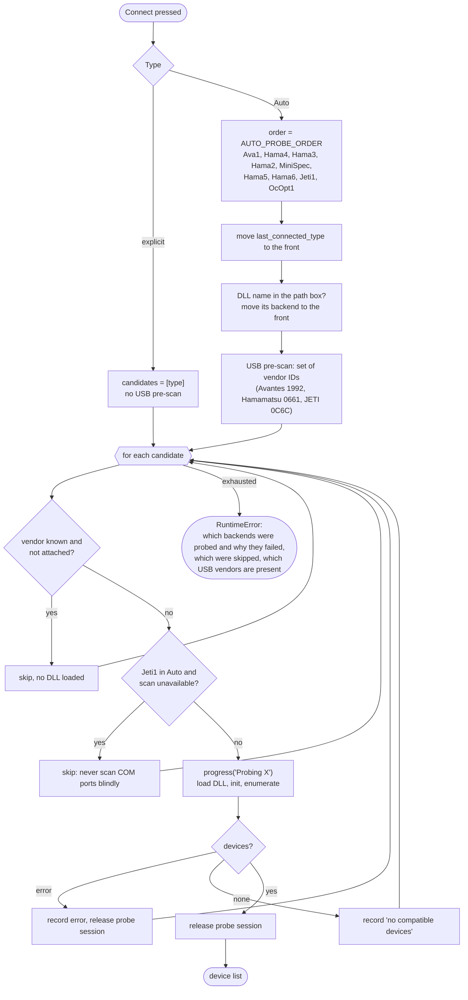

### 6.4 Connect sequence

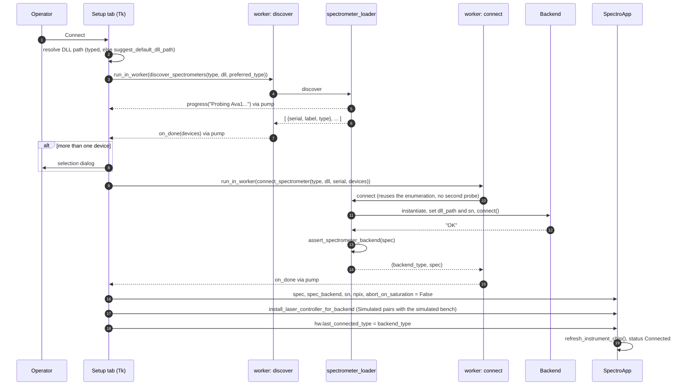

### 6.5 Acquisition state inside a backend

All drivers follow the same acquisition shape, whether the vendor SDK is callback-driven (Avantes), polled (Hama6, Jeti1, OceanDirect) or thread-pumped (MiniSpec):

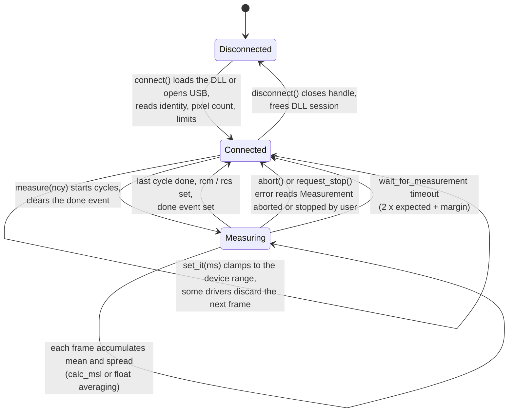

Driver-specific behaviour worth knowing when reading a log:

- **Hama6** runs every .NET call on one worker thread with a 15 s watchdog; a blocked call becomes an error and marks the backend blocked until SciLab restarts. It never selects capture mode 1 (free run) and never writes the exposure cycle, both of which were found to wedge or starve the board.
- **Jeti1** sends one firmware measurement per cycle and averages in floating point; Stop sends the break, which firmware 0.66.0 does not acknowledge, so the next measurement waits for the cancelled exposure to end.
- **OcOpt1** switches the SDK's electric-dark and nonlinearity corrections off so raw counts are recorded; a Flame-S frame cannot be aborted mid-exposure, so abort stops between frames.
- **MiniSpec** owns the DCamUSB session on a dedicated lifecycle thread (the DLL is thread-affine) and tells apart "no matching interface" from "driver missing" when native error 4 appears.
- **Simulated** integrates the light that is on at exposure start, scales counts with IT, clips at 65,535, and adds dark offset, fixed-pattern, read and shot noise.

## 7. Light sources, head sensor and stage

### 7.1 Serial controllers

`LaserController` owns three `SerialDevice` paths. Each `command()` opens the port on demand, optionally resets buffers, writes the text with the device's line ending, and either sleeps a fixed pause and reads what is buffered (the historical behaviour) or, with the bench option `framed_serial_reads`, waits for the reply terminator.

| Device | Port setting | Baud, framing | Commands used | Notes |
| --- | --- | --- | --- | --- |
| OBIS laser box | `com_ports["OBIS"]` | 9600, CR LF | `SOURn:POW:LEV:IMM:AMPL <W>`, `SOURn:AM:STAT ON/OFF` | pause 0.2 s per command |
| CUBE 377 nm laser | `com_ports["CUBE"]` | 19200, CR, 8N1 | `EXT=1`, `CW=1`, `P=<mW>`, `L=1`, `L=0` | arm takes 3 x 1 s waits; emit waits 3 s to settle; retries 3 |
| Relay board | `com_ports["RELAY"]` | 9600, CR | `R<n>S` set, `R<n>R` reset | no buffer reset before a command (kept from v3.3); pause 0.05 s |
| Head sensor / filter wheels | `com_ports["HEADSENSOR"]` | 4800, CR | `?` identity (expects `Pan...`), `F<w><pos>`, `F<w>r` reset, `F<w>m` test | `FilterWheelController`, status history of 50 entries |
| Stage (Oriental Motor AZ-series drivers, two slaves) | `com_ports["STAGE"]` or the stage config's port | Modbus RTU 115200, 8E1 | AZ holding registers: direct-data move (position, speed, accel, decel), command bits (start, home, stop, free, alarm reset, jog), status bits (ready, moving, alarm), feedback position, torque | `ModbusManager` with the AZ 20 ms turnaround delay per slave and failure counts |

### 7.2 Source routing

Every source tag maps to one controller and channel. The same table is used by the Live View and Check Resolution checkboxes (`SpectroApp.set_source_state`) and by the orchestrator (`_ensure_source_state`), so the lit-source chip in the app bar is right no matter which path did the switching.

| Tag | Controller | Channel | Power unit in settings | Default start IT for auto-IT |
| --- | --- | --- | --- | --- |
| 377 | CUBE | shutter `L=1` | W if value <= 0.3 (converted to mW), else mW | 2.4 ms, after a 3 s stabilisation wait |
| 405 | OBIS | 5 | W | 2.4 ms |
| 445 | OBIS | 4 | W | 2.4 ms |
| 488 | OBIS | 3 | W | 2.4 ms |
| 517 | RELAY | 2 | n/a | 80 ms |
| 532 | RELAY | 1 | n/a | 20 ms |
| 640 | OBIS | 2 | W | fixed ladder 100 / 500 / 1000 ms, no auto-IT |
| 685 | OBIS | 6 | W | 2.4 ms |
| Hg_Ar | RELAY | 4 | n/a | 20 ms, preceded by a 45 s fibre-switch countdown |

`all_off()` is the safety path: it switches every OBIS channel, relays 1 to 4 and the CUBE off, logs each device that does not answer, and returns their names. It runs before and after every measurement run, from the app-bar All off button, and on exit.

### 7.3 Stage safe move

The stage subsystem reads slot definitions and motor parameters from the external Stage Software `config.json`, connects over Modbus RTU and moves to a slot in a background thread with a fixed safe order, polling the status register every 150 ms with a 60 s timeout per axis.

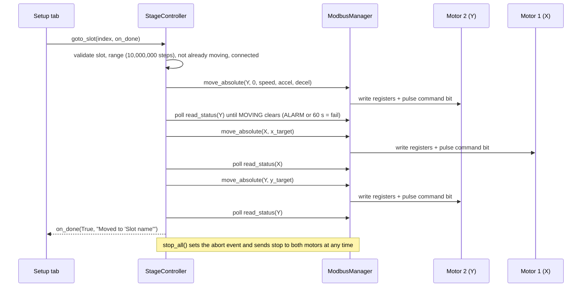

## 8. The measurement run

### 8.1 Sequence

`MeasurementOrchestrator.run(tags)` is the whole measurement, free of Tk. The Measurements tab builds its configuration from the application's tunables and a snapshot of the laser powers taken on the Tk thread, wires the callbacks, and runs it on a worker thread. 640 nm always runs last because it uses a fixed integration ladder instead of auto-IT.

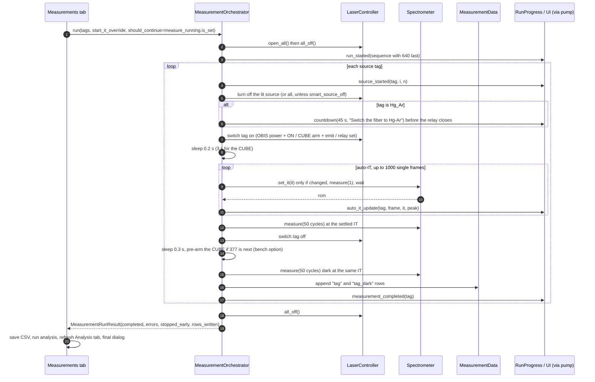

A source whose measurement raises (a backend error, saturation at the minimum IT, or auto-IT leaving the band unreached) is recorded in `result.errors`, reported through `source_failed`, and the run continues with the next source. Stop pressed mid-capture ends the run as `stopped_early` without an error dialog.

### 8.2 Auto-exposure (Auto-IT)

The controller is the v3.3 additive stepper. Each unsaturated single frame moves the integration time by `|target_mid - peak| / 5000` ms, never less than 0.05 ms and never more than 0.3 ms upward or 0.1 ms downward, so the exposure creeps toward the band and slows as it gets close. A saturated frame carries no amplitude information and backs off by 30 %. Versions 3.4.0 to 3.4.2 jumped proportionally to `it x target / peak`; on a detector whose first frame is mostly dark offset that sent the exposure to about 200 ms in one step, so the stepper was restored in 3.4.3 and a test now asserts that no frame-to-frame jump exceeds the step limits.

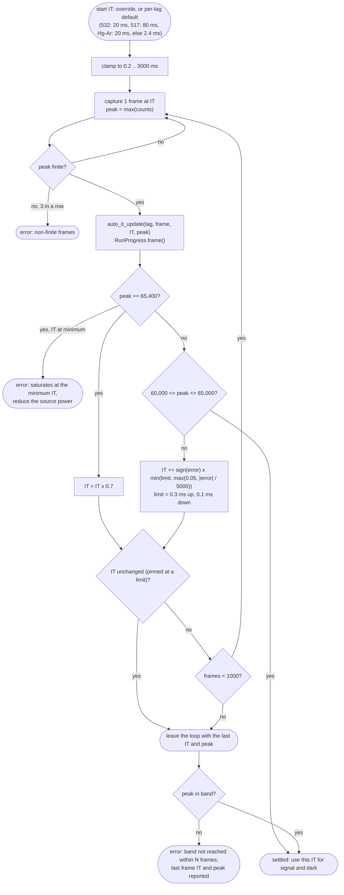

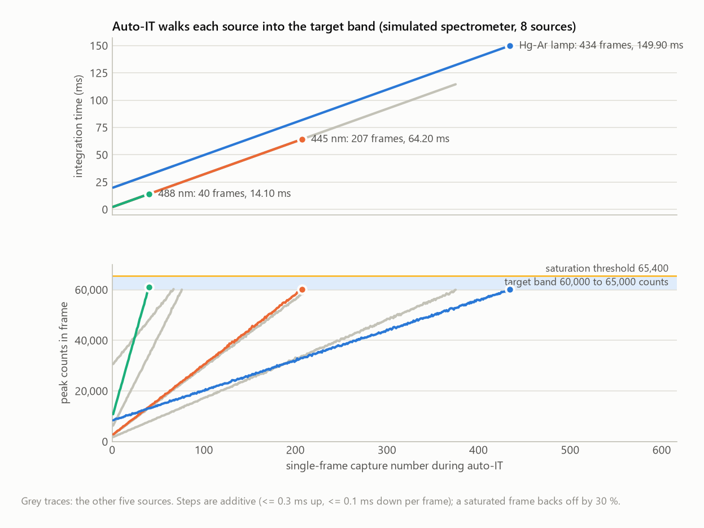

*Figure 3 (measured). The real orchestrator run against the simulated bench with the application's tunables. Each source creeps linearly in integration time until its peak enters the band; a dim source such as the simulated lamp needs hundreds of frames, a bright one a few dozen, and 517 nm settles on its first frame because its 80 ms default already lands in the band.*

Frames per source in that simulated run:

| Source | 517 nm | 488 nm | 532 nm | 377 nm | 445 nm | 685 nm | 405 nm | Hg-Ar |
| --- | --- | --- | --- | --- | --- | --- | --- | --- |
| Auto-IT frames | 1 | 40 | 67 | 76 | 207 | 212 | 375 | 434 |

Tunables (class attributes on `SpectroApp`, copied into `MeasurementOrchestratorConfig` per run):

| Name | Value | Meaning |
| --- | --- | --- |
| `TARGET_LOW`, `TARGET_MID`, `TARGET_HIGH` | 60,000 / 62,500 / 65,000 counts | the band; the Measurements tab lets the operator move the mid-point, the band is mid +/- 2,500 |
| `IT_MIN`, `IT_MAX` | 0.2 ms, 3000 ms | clamp |
| `IT_STEP_UP`, `IT_STEP_DOWN` | 0.3 ms, 0.1 ms | largest additive step per frame |
| `IT_STEP_FLOOR_MS`, `IT_STEP_COUNTS_PER_MS` | 0.05 ms, 5000 counts/ms | step shaping near the band |
| `MAX_IT_ADJUST_ITERS` | 1000 | frame budget per source |
| `SAT_THRESH` | 65,400 counts | saturation for auto-IT; `saturation_backoff` 0.7 |
| `N_SIG`, `N_DARK` | 50, 50 cycles | signal and dark averaging |
| `N_SIG_640`, `N_DARK_640`, `nm640_integrations` | 10, 10, (100, 500, 1000) ms | the 640 nm ladder for out-of-range (stray light) analysis |
| `source_delay_s`, `cube_stabilize_delay_s`, `dark_delay_s`, `nm640_warmup_delay_s` | 0.2, 3.0, 0.3, 1.0 s | settling waits |

Bench-validated speed options (Setup, Advanced; off by default and saved with Settings):

| Flag | Effect | Risk being validated |
| --- | --- | --- |
| `smart_source_off` | turn off only the lit source between lasers instead of `all_off()` before each one | saves 1 to 2 s of serial sleeps per source; relies on the lit-source bookkeeping |
| `cube_prearm` | send the CUBE's `EXT`/`CW`/`P` setup (no emission) during the previous source's dark capture | 377 nm then needs only `L=1` plus the settle; CUBE must tolerate being armed early |
| `framed_serial_reads` | wait for the reply terminator instead of fixed sleeps | a fast device answers in milliseconds, a slow one is not cut off; depends on terminators being consistent |

### 8.3 Run progress model

`RunProgress` is the thread-safe record the orchestrator's callbacks write from the worker and that the Measurements card and the app-bar chip read as snapshots on the Tk thread. State transitions notify listeners; auto-IT frames only update numbers, which the panels poll every 200 ms while a run is in flight.

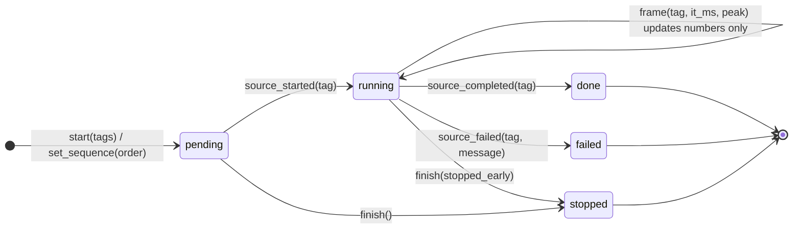

Run-level status is `idle`, `running`, `stopped` (any source cut short) or `finished` (every source ran, some may have failed). The chip hides itself 20 s after a run ends.

## 9. Data model and persistence

### 9.1 Data flow

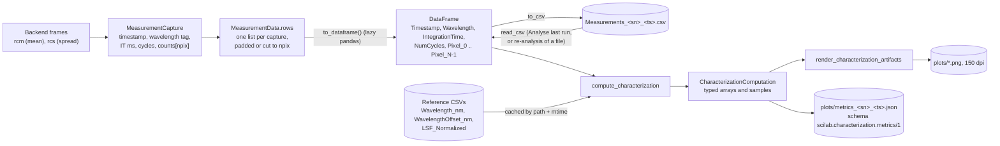

### 9.2 Measurement rows

| Column | Type | Content |
| --- | --- | --- |
| `Timestamp` | text `YYYY-MM-DD HH:MM:SS` | wall clock at capture |
| `Wavelength` | text tag | `"405"` for a signal row, `"405_dark"` for its dark; `"640"` appears three times, once per ladder step |
| `IntegrationTime` | float ms | the settled auto-IT value (same for the signal row and its dark) |
| `NumCycles` | int | 50 for laser signal and dark, 10 for the 640 nm ladder |
| `Pixel_0` .. `Pixel_<npix-1>` | float counts | mean counts per pixel; the per-pixel spread (`rcs`) is not persisted |

### 9.3 Files on disk

```text
<writable base>/
  spectro_gui_settings.json           operator settings (atomic write: temp file + os.replace)
  self-test.log                       last --self-test report
  results/
    <serial>_<YYYYMMDD_HHMMSS>/       one folder per run (created at first save)
      Measurements_<serial>_<ts>.csv
      plots/
        Normalized_Laser_Plot_<sn>_<ts>.png
        OOR_640nm_Plot_<sn>_<ts>.png
        HgAr_Peaks_Plot_<sn>_<ts>.png
        SDF_Plot_<sn>_<ts>.png
        SDF_Heatmap_<sn>_<ts>.png
        Dispersion_Fit_<sn>_<ts>.png
        A2_A3_vs_Wavelength_<sn>_<ts>.png
        Spectral_Resolution_with_wavelength_<sn>_<ts>.png
        Slit_Functions_<sn>_<ts>.png
        Normalized_LSFs_Measured_Lasers_<sn>_<ts>.png
        <sn>_Reference_<name>_Normalised_LSF_<ts>.png   (one per reference CSV)
        Normalized_LSFs_HgAr_Lamp_<sn>_<ts>.png
        metrics_<sn>_<ts>.json
      CheckSpectrometer_<sn>_<ts>.csv, <sn>_<site>_<ts>_CheckSpectrometer.jpg / .ddf   (Check Spectrometer)
```

Only the plots whose inputs exist are written: a run without the lamp has no Hg-Ar plots, a run without 640 nm has no out-of-range plot. A typical laser-plus-lamp run produces eight PNGs.

The writable base is chosen once per process:

| Running as | Base directory |
| --- | --- |
| frozen build (installed) | `%LOCALAPPDATA%\SciLab` (Program Files is read-only for an operator); falls back to the executable's folder |
| source checkout | the repository directory |
| neither writable | `~/.head-scilab`, then the temp directory |

### 9.4 Settings

`spectro_gui_settings.json` is written by Setup's Save Settings, by Ctrl+S, and silently on exit.

| Key | Content |
| --- | --- |
| `spectrometer_type` | type to pre-select; Setup always opens on Auto and uses the saved type as a probe hint |
| `last_connected_type` | the backend that connected most recently; Auto probes it first |
| `dll_path` | vendor DLL path typed by the operator (a suggested path is cleared when Auto is selected) |
| `com_ports` | `OBIS`, `CUBE`, `RELAY`, `HEADSENSOR`, `STAGE` |
| `laser_power`, `laser_configs` | per-tag power and controller type (`OBIS`, `CUBE`, `RELAY`) |
| `available_lasers` | the tags shown on every tab (Hg_Ar is always present) |
| `stage_config_path` | path to the Stage Software `config.json` |
| `measurement_flags` | `smart_source_off`, `cube_prearm`, `framed_serial_reads` |

## 10. Analysis pipeline

### 10.1 Stages

`compute_characterization` turns the measurement DataFrame into typed arrays; `render_characterization_artifacts` draws them; `AnalysisService` coordinates both and persists the numbers. Rendering never influences the numbers.

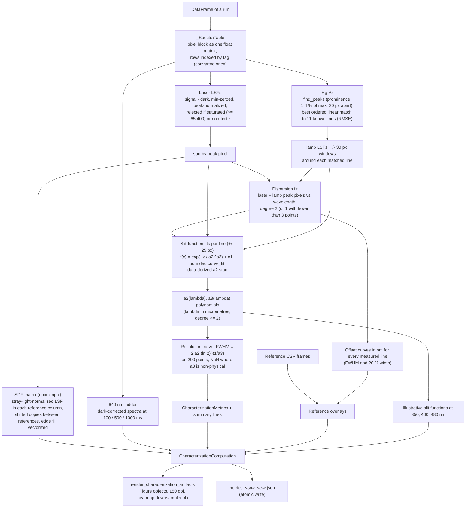

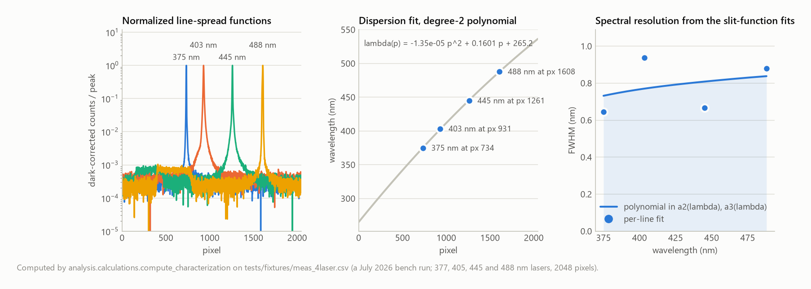

*Figure 4 (measured). `compute_characterization` on `tests/fixtures/meas_4laser.csv`, one of the four golden CSVs. Left: the four dark-corrected, peak-normalized line-spread functions on a log scale; the floor near 1e-4 is the instrument's stray light and noise. Middle: the degree-2 dispersion polynomial through the four peak pixels. Right: the resolution curve derived from the per-line slit-function fits (dots) and the fitted a2 and a3 polynomials (line).*

### 10.2 The slit-function model

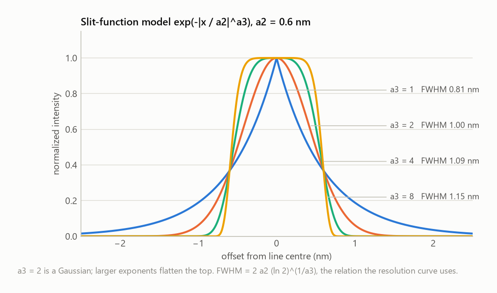

*Figure 5 (measured). `analysis.calculations.slit_func` for one width and four shape exponents. The analysis fits a2 (width), a3 (shape) and c1 (baseline) per line within physical bounds, then fits low-order polynomials to a2 and a3 over wavelength. The FWHM relation shown is the one the resolution curve uses, and the same relation is used by the simulator to construct its emission lines.*

### 10.3 Configuration

All analysis constants live on `CharacterizationConfig` with the historical values as defaults:

| Field | Default | Used for |
| --- | --- | --- |
| `laser_sequence` | 377, 405, 445, 488, 517, 532, 640, 685 | tags analysed as LSFs (Hg-Ar handled separately) |
| `laser_reference_map` | 377 -> 375.0, 405 -> 403.46, others nominal | true line wavelength per tag |
| `known_lines_nm` | 289.36 .. 546.08 (11 Hg-Ar lines) | lamp peak matching; a second attempt drops the last line |
| `ib_region_size` | 20 px | in-band region zeroed for stray-light normalisation of the SDF |
| `sat_threshold` | 65,400 | LSF rejection |
| `win_hg` | 30 px | half window for lamp LSFs |
| `peak_prominence_fraction`, `peak_min_distance_px` | 0.014, 20 | `find_peaks` tuning for a 2048-pixel, ~0.155 nm/px instrument |
| `fit_window_px` | 25 px | half window for slit-function fits |
| `slit_a2_bounds`, `slit_a3_bounds`, `slit_c1_bounds` | (0.001, 10) nm, (0.5, 12), (-0.5, 0.5) | fit bounds |
| `slit_example_wavelengths_nm`, `slit_example_a2_clip` | 350, 400, 480 nm; (0.2, 5.0) | illustrative curves |
| `resolution_curve_points` | 200 | resolution curve sampling |

### 10.4 Check Spectrometer and Check Resolution

Both use the same modified-Gaussian line model `f(x) = B + A exp(-0.5 |(x - xcen) / w|^n)` fitted with bounded `curve_fit`. **Check Spectrometer** (a button on Live View) is a one-shot routine: proportional auto-IT to 60 % of full scale within 12 iterations, a 3 s single frame, dark correction from the blind pixels when the backend reports them, a +/- 40 px window around the brightest pixel, the fit, a diagnostic plot, a CSV and a data dump, all under the run folder, with the result shown as an Analysis run tab. **Check Resolution** is the live version: it streams frames and refits every frame so the operator can adjust focus and alignment while watching centre, width and shape react.

## 11. User interface

### 11.1 Tabs and shortcuts

| Tab | Shortcut | Built | Purpose |
| --- | --- | --- | --- |
| Setup | Ctrl+1 | eagerly | backend, DLL, COM ports with test buttons, lasers and powers, stage, Advanced bench options, Connect, Save Settings (Ctrl+S), Refresh Ports (F5) |
| Live View | Ctrl+2 (Ctrl+L toggles streaming) | lazily, warmed up at startup | live trace with blitting, IT spinbox applied between frames, readout card (peak, pixel, percent full scale, saturation, IT, fps), source checkboxes, Check spectrometer |
| Measurements | Ctrl+3 | eagerly (figure created on first show, warmed up) | source checkboxes and presets, target peak, Auto-IT start, reference CSVs, Run Selected / Stop / Save CSV / Analyse last run, run progress card, live Auto-IT plot |
| Check Resolution | Ctrl+4 | lazily, warmed up | live line fit with fit readouts |
| Analysis | Ctrl+5 | eagerly | run tabs with PNG previews (at most 5 kept, about 10 MB each), summary, Export plots, Open folder, Clear All |
| EEPROM | Ctrl+6 | lazily, warmed up | Avantes EEPROM read and write (red "Write" buttons) |
| Log drawer | F12 | always | colour-tagged event log above the status bar; counts unseen warnings on its button |

### 11.2 App bar and status

The white title strip carries the SciGlob mark, the product name and version, and three chips: the instrument (backend and serial, green when connected), the lit sources (amber, with an **All off** button that stops a running measurement first), and the run (hidden when idle, amber while measuring, outcome shown for 20 s afterwards; a click opens Measurements). The status bar at the bottom shows messages, a progress bar for runs and probes, toasts, and the Log toggle.

### 11.3 Rendering live data

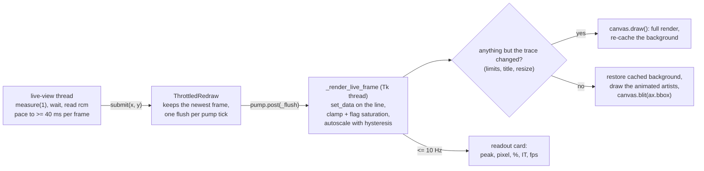

A full matplotlib draw of a 2048-point trace with ticks, grid and legend costs tens of milliseconds; restoring a cached background and drawing only the line costs a few. The same `ThrottledRedraw` pattern drives the Auto-IT plot on Measurements and the fit overlay on Check Resolution.

### 11.4 Theme and scaling

`tabs/theme.py` resolves fonts once per process: the base size is 10 pt on a 1080p-class screen, 11 pt on 1440p, 12 pt on 4K at 125 %, 9 pt on a 768 px-tall laptop, and `SCILAB_UI_SCALE=1.0` pins the compact size. Paddings, control sizes, scrollbars, tree rows, plot typography and layout breakpoints all scale through `Fonts.SCALE` and `logical_px`. Sources are tinted toward their wavelength (with the wavelength always written out), controller types appear as badges, and `harmonize()` re-tints labels and frames to their container on every tab activation so late-created widgets never show as grey blocks on white cards.

## 12. Packaging, installation and self-test

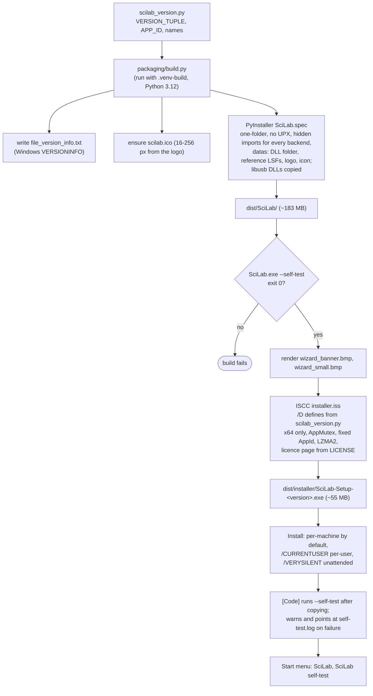

Design choices recorded in `packaging/README.md`:

- **One folder, not one file.** A one-file build unpacks the whole scientific stack on every launch and hands the vendor DLLs a different path each run; a folder also lets support replace a single DLL in place.
- **No UPX.** Compressed scientific DLLs trip antivirus heuristics.
- **Hidden imports are load-bearing.** Backends are imported through `importlib`, invisible to PyInstaller; the self-test imports every one so a bundle that lost a backend fails the build instead of reporting "No spectrometer detected" on a bench.
- **Python 3.12** is the build base because it is the only version that carries pythonnet (Hama6) alongside matplotlib, pyusb and Tk.
- **Fixed `APP_ID`** so Windows upgrades an installed copy in place. **Uninstall leaves `%LOCALAPPDATA%\SciLab` alone** because it holds measurement results.

## 13. Testing strategy

| Level | What it exercises | How | Files |
| --- | --- | --- | --- |
| Pure functions | slit function, FWHM, stray-light normalisation, peak matching, polyfit clamps, LSF extraction | synthetic Gaussians, exact expectations | `test_analysis_pure.py` |
| Golden regression | `compute_characterization` end to end | four real bench CSVs in `tests/fixtures/` pinned in `tests/golden/snapshot.json`; regenerate with `tests/golden/make_snapshot.py` only when a numeric change is intended | `test_analysis_golden.py` |
| Workflow | the orchestrator: all rows written, sources off, additive stepping with no jumps, dim source creeps, saturation at minimum IT reported, bench options, Stop, backend errors recorded, 640 ladder, `set_it` skipped when unchanged, progress callbacks | `SimulatedSpectrometer` + `SimulatedLaserController`, `time_scale=0` | `test_orchestrator.py`, `test_run_progress.py` |
| Hardware protocol | Hama5 USB protocol, Hama6 .NET call layer and sample sequence, JETI SDK sequence and stop semantics, OceanDirect cycle loop, MiniSpec session lifecycle, Hamamatsu diagnostics | fake devices and fake SDKs injected in place of the DLLs | `test_hama5.py`, `test_hama6.py`, `test_jeti_backend.py`, `test_oceandirect_backend.py`, `test_minispec_lifecycle.py`, `test_hamamatsu_diagnostics.py` |
| Loader | probe order, preferred type, USB vendor gating, Jeti1 gate, failure message, connect reuses discovery | monkeypatched probes | `test_loader.py` |
| UI plumbing | pump ordering, cross-thread post, `call_sync`, throttled redraw, acquisition guard | Tk-free fakes with `after` | `test_ui_pump.py` |
| Startup contract | eager modules do not import pandas or scipy | fresh interpreter import set | `test_startup_imports.py` |
| GUI smoke | every tab builds, simulated frames stream into Live View, Check Resolution fits, disconnect restores hardware lasers, chips and progress follow the model, idle button states, log drawer | a real `SpectroApp` with the Simulated backend; self-skips without Tk | `test_smoke_gui.py` (marker `gui`) |

Figure 1 (right panel) shows the distribution. Commands:

```bash
python -m pytest tests -q --ignore=tests/test_smoke_gui.py   # 177 cases, any Python with numpy/scipy/pandas
python -m pytest tests/test_smoke_gui.py -q                   # 10 cases, needs Tk and a display
ruff check .                                                  # E, F, W, B006, B008 (see pyproject.toml)
```

Bench checks that complement the suite: `tools/jeti_smoke_test.py`, `tools/oceandirect_smoke_test.py`, `tools/diagnose_c13016.py`, `tools/diagnose_hamamatsu.py`, and `SciLab.exe --self-test` on an installed machine.

## 14. Performance

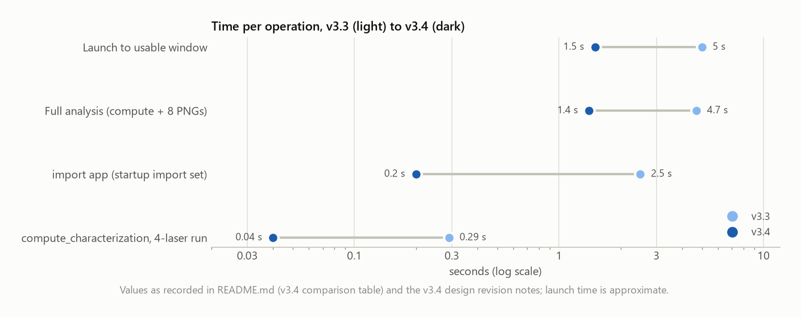

*Figure 6 (quoted). The four operations the operator waits on most, before and after the v3.4 work, on a log axis because they span two orders of magnitude.*

| Metric | v3.3 | v3.4 | How |
| --- | --- | --- | --- |
| Launch to a usable window | about 5 s (2.5 s imports, 2.5 s fixed splash, build) | about 1.5 s | imports behind the splash, window built out of sight, pandas and scipy deferred to a worker |
| `import app` | about 2.5 s | about 0.2 s | no pandas, scipy or analysis imports on the startup path |
| Full analysis (compute + plots) | about 4.7 s, 12 PNGs at 300 dpi, 2 blank | about 1.4 s, 8 PNGs at 150 dpi, plus metrics JSON | vectorised SDF fill, pixel matrix hoisted once, 150 dpi, heatmap downsampled 4x, blank figures skipped |
| `compute_characterization`, 4-laser run | about 290 ms | about 40 ms | numpy views instead of Python loops over a 2048 x 2048 matrix, no per-row pandas label indexing |
| Live plot | full redraw per frame, unbounded rate | blitted trace over a cached background, 25 fps cap, autoscale hysteresis | `BlitRenderer`, `ThrottledRedraw`, `_LIVE_MIN_FRAME_S = 0.04` |
| Auto discovery | every DLL loaded and initialised on the Tk thread, sessions leaked, hardware enumerated twice | worker thread, preferred type first, USB pre-scan skips absent vendors, sessions released, enumeration reused on connect | `spectrometer_loader.py` |
| Analysis previews | live matplotlib canvases per plot, memory grew for the session | PNG thumbnails decoded on a worker, at most 5 run tabs kept | `refresh_analysis_view`, `_prune_analysis_tabs` |
| Hama4 `set_it` | stop and restart of the stream with a 0.2 s pause on every call | skipped when the value is unchanged (signal and dark reuse the settled IT) | `MeasurementOrchestrator._apply_it` |

## 15. Failure handling and safety

| Situation | Detection | Behaviour |
| --- | --- | --- |
| Second copy of SciLab started | named mutex already exists | the running window is brought to the front; the new process exits |
| No spectrometer found in Auto | every candidate probed, skipped or errored | one dialog listing what was probed and why it failed, what was skipped, and which USB vendors are present |
| Two features want the spectrometer | `AcquisitionGuard.try_acquire` false | "X is running. Stop it first." on the Tk thread; nothing touches the device |
| Stop pressed during a capture | `measure_running` cleared, `request_stop()` | the backend aborts and wakes the waiter; the run ends as stopped without an error dialog; partial CSV is saved |
| Vendor call never returns | per-backend watchdogs (Hama6 15 s per call, others `wait_for_measurement` timeout 2 x expected + margin) | an error with the status codes instead of a frozen window; Hama6 asks for a restart and re-plug |
| Source saturates at the minimum IT | auto-IT branch | the source is reported in the run summary; the run continues |
| Auto-IT cannot reach the band | frame budget or IT limit hit | the source fails with the last IT and peak in the message; the run continues |
| Backend error on one source | exception in the orchestrator loop | recorded in `result.errors`, shown as failed in the progress card with a tooltip, run continues |
| Non-finite frames | three in a row | source fails with a clear message |
| Serial device does not answer | `SerialDevice.command` empty reply, exceptions | checkbox reverts, status strip reports; `all_off` logs each unreachable device once and returns their names |
| Window closed | `WM_DELETE_WINDOW` | pump stopped first; live and measurement stopped; settings saved; **every source switched off**; spectrometer disconnected; serial ports, head sensor and stage closed |
| Installed build cannot write next to the executable | write probe on the base directories | `%LOCALAPPDATA%\SciLab`, then home, then temp |
| Settings write interrupted | atomic write | temp file + `os.replace`, so a half-written file never resets a bench's COM ports |
| Frozen bundle lost a backend or DLL | `--self-test` at build time, at install time and from the Start menu | the build fails; the installer warns and names the log file |
| Stage move alarm or 60 s timeout | status register poll | move reported failed; `stop_all` available at any moment |

## 16. Known limitations

- **Auto picks the first backend that finds a device.** With an Avantes and an Ocean Insight unit attached, Auto connects the Avantes (Ava1 precedes OcOpt1 in the probe order). Select the type explicitly on a multi-vendor bench.
- **Hama5 and the C10785-on-MiniSpec mapping are not bench validated.** Hama5 is tested only against a fake USB device; the C10785 assignment rests on inspection of `DCamUSB.dll`.
- **Hama6 head calibration.** The C13016 board reports the head's serial and sensor, not its model, and keeps the wavelength polynomial of the head it was calibrated with. A `hama6_wavelength_coefficients.json` beside the DLL, keyed by head serial, overrides it.
- **JETI PE60_2 stop.** Firmware 0.66.0 does not acknowledge the break; Stop returns within a second but the next measurement waits for the cancelled exposure. The bench board also carries JETI's placeholder wavelength fit and has shown no sensor signal yet.
- **OceanDirect cannot be redistributed.** OcOpt1 needs the SDK installed on the target PC (or `OCEANDIRECT_HOME`); the installer does not carry the DLL. Flame-S exposes no temperature readout through OceanDirect.
- **Hama2 needs the Hamamatsu DCAM runtime** installed separately.
- **`rcs` is not persisted.** The per-pixel spread is used for the Check Resolution fit weights and the live readouts but does not reach the CSV.
- **`app.py` still carries a lot of shared state** (about 1,400 lines), and `tabs/setup_tab.py` is the broadest UI module (about 1,500 lines). Results persistence lives in the shell rather than in a repository module.
- **Analysis tuning is instrument-specific.** Peak prominence and distance were tuned for a 2048-pixel, 0.155 nm/px instrument; a 288-pixel C13016 head or a different grating needs different `CharacterizationConfig` values.

## 17. Roadmap

Carried over from the refactor notes and the bench studies, in rough priority:

1. Bench validation of the measurement path on each supported family, in particular Hama5 and C10785 (MiniSpec), and a PE60_2 with a working sensor board.
2. Pull results persistence (run folder, CSV, metrics, Check Spectrometer outputs) into a small repository-style module so `app.py` shrinks.
3. A hardware-session service owning connect, disconnect and capability reporting (pixels, blind pixels, IT range, wavelength axis), so tabs stop reading backend attributes directly.
4. Persist `rcs` alongside `rcm`, and make `CharacterizationConfig` selectable per instrument class (2048-pixel vs 288-pixel heads).
5. Continue shrinking `tabs/setup_tab.py`; add smoke tests around connection setup and analysis edge cases (single line, lamp only).
6. Clarify OceanDirect redistribution with Ocean Insight so OcOpt1 can ship in the installer.

---

## Appendix A: Figures and how to regenerate them

| Figure | File | Source of the data |
| --- | --- | --- |
| 1 | `figures/fig-codebase-and-tests.png` | measured: line counts and `def test_` counts in this checkout |
| 2 | `figures/fig-startup-timeline.png` | quoted: `README.md`, `main.py` docstring and constants |
| 3 | `figures/fig-auto-it-convergence.png` | measured: `MeasurementOrchestrator.run` on `SimulatedSpectrometer` (seed 1234, `time_scale=0`) with the `SpectroApp` tunables |
| 4 | `figures/fig-analysis-example.png` | measured: `compute_characterization` on `tests/fixtures/meas_4laser.csv` |
| 5 | `figures/fig-slit-function-family.png` | measured: `analysis.calculations.slit_func` and `compute_fwhm` |
| 6 | `figures/fig-performance-v33-v34.png` | quoted: `README.md` v3.4 comparison table |

Regenerate all six from the repository root:

```bash
python docs/figures/make_figures.py
```

The script uses the project's own code paths, so a change to the auto-IT stepper or to the analysis maths shows up in Figures 3 and 4 the next time it runs. The Mermaid diagrams in this document render natively on GitHub and in editors with Mermaid support.

## Appendix B: Glossary

| Term | Meaning |
| --- | --- |
| IT, integration time | exposure time of one frame, in milliseconds |
| Auto-IT | the automatic search for an IT that puts the brightest pixel in the target band |
| cycle | one frame within a `measure(ncy)` call; the backend averages the cycles |
| `rcm`, `rcs` | mean counts and per-pixel standard deviation of the last measurement |
| dark | a capture with the source off at the same IT, subtracted from the signal |
| LSF | line-spread function: the instrument's response to a monochromatic line, dark-corrected and peak-normalized |
| SDF | the npix x npix matrix of stray-light-normalized LSFs, one column per pixel, built by shifting the measured LSFs |
| dispersion | the pixel-to-wavelength polynomial |
| slit function | the model `exp(-|x / a2|^a3) + c1` fitted to each line; a2 is the width, a3 the shape exponent |
| FWHM | full width at half maximum, the resolution measure; `2 a2 (ln 2)^(1/a3)` for the slit function |
| OOR | out-of-range: the 640 nm ladder used to look at stray light far from the line |
| blind pixels | optically black pixels at the ends of a detector, used for dark estimation in Check Spectrometer |
| OBIS, CUBE | Coherent laser product lines, driven over serial |
| Hg-Ar | the mercury-argon calibration lamp, switched through the relay board, with known emission lines |
| backend | a Python module driving one spectrometer family through the `SpectrometerBackend` contract |
| UI pump | the single queue drained on the Tk thread through which workers update the interface |
| acquisition guard | the single-owner token for the spectrometer handle |
| frozen build | the PyInstaller bundle that runs without a Python installation |
