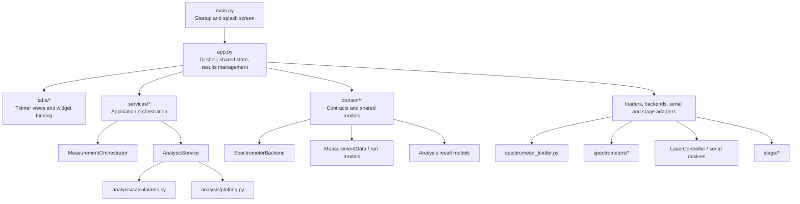
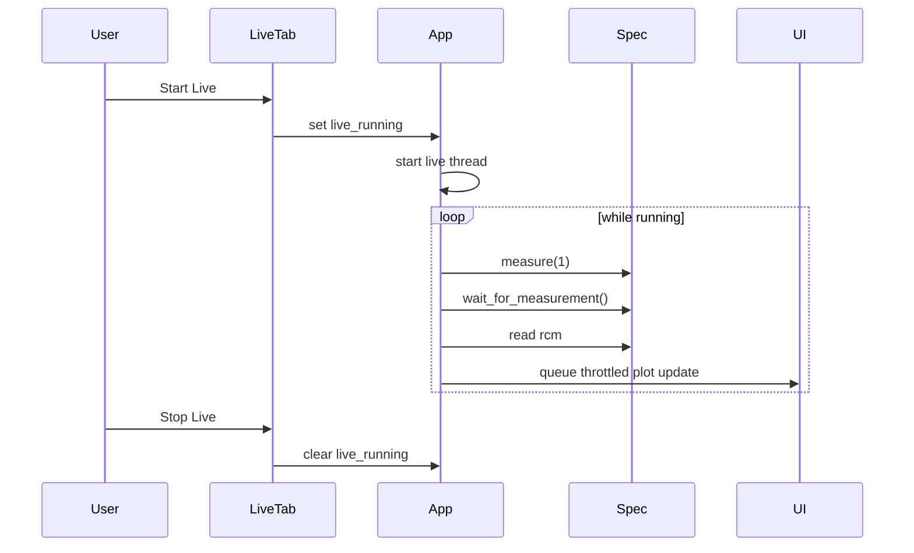
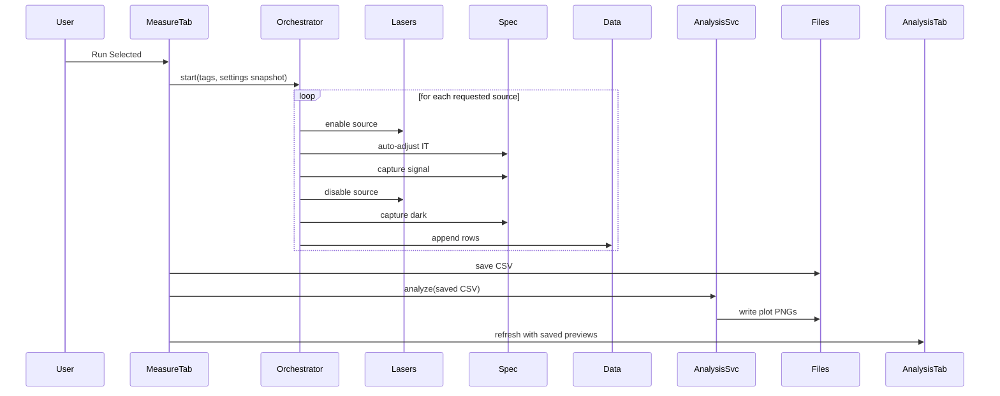

# All Spec Laser Control System Design

Status: Revision 1.1  
Date: 2026-04-06  
Author: Ashutosh Joshi

## Overview

This document describes the architecture that is now in the repository after the April 2026 refactor. It is meant to be practical. The goal is not to describe an idealized future system. The goal is to help the next engineer understand how the application is put together today, why a few structural changes were made, and where the remaining pressure points still are.

All Spec Laser Control is still a desktop lab application built with Python and Tkinter. That has not changed, and it should not be treated as a problem in itself. The software needs to live on a workstation next to the hardware, work offline, and stay usable for operators who are running setup, acquisition, analysis, and maintenance in one place.

What did change is the shape of the code underneath the UI:

- The spectrometer backends now have a formal contract.
- The measurement sequence is no longer buried inside the Measurements tab.
- Analysis calculations are now separated from plot rendering and from UI presentation.
- The GUI does less work per frame, especially in Live View, Auto-IT, and the Analysis tab.

## What The Application Does

At a high level, the application handles a fairly specific lab workflow:

- Discover and connect to one of several supported spectrometer families
- Control external light sources over serial
- Capture live spectra
- Run automated characterization measurements across selected sources
- Save raw measurement data to disk
- Generate analysis outputs and plots for the run
- Provide EEPROM and stage-control utilities where supported

That workflow is still exposed through the same operator-facing tabs:

- Setup
- Live View
- Measurements
- Analysis
- EEPROM

## What Changed In This Revision

The refactor in this revision was aimed at reducing coupling without disturbing the operator workflow.

### 1. Spectrometer backend interface was formalized

The codebase used to rely on a shared, unwritten convention across spectrometer backends. That was workable, but brittle. We now have a concrete runtime contract in `domain/spectrometer.py` built around `SpectrometerBackend`, along with validation helpers used at connection time.

This does two useful things:

- it makes backend expectations obvious
- it fails early if a new backend drifts from the required shape

### 2. Measurement workflow moved into an orchestrator

The measurement sequence used to live directly inside `tabs/measurements_tab.py`. That meant the UI layer was also responsible for source control, Auto-IT, dark capture, special-case handling, and error sequencing.

That logic now lives in `services/measurement_orchestrator.py`. The tab is back to doing UI work: reading operator inputs, starting the run, forwarding progress updates, and showing results.

### 3. Analysis was split into calculation and rendering layers

The old `characterization_analysis.py` module mixed together three different concerns:

- scientific calculations
- plot generation
- the result object handed back to the UI

That has now been separated into:

- `analysis/calculations.py` for metrics and computed analysis structures
- `analysis/plotting.py` for writing plot images
- `services/analysis_service.py` as the orchestration layer used by the app

`characterization_analysis.py` still exists as a small compatibility facade so existing imports do not break.

### 4. GUI responsiveness was improved in a few hot spots

There was no single dramatic performance bug. The sluggishness came from a handful of small things stacking up:

- too many redraw requests during live acquisition
- too many redraw requests during Auto-IT
- the Measurements tab updating its plot aggressively
- the Analysis tab embedding live Matplotlib canvases for every saved plot

Those hotspots were addressed by batching redraws and by switching the Analysis tab to lightweight PNG previews instead of full embedded plot canvases.

## Current Architecture

This is still a single-process desktop application. The difference now is that the internal boundaries are clearer.



The important point here is simple: the UI still drives the application, but the business logic is no longer expected to live inside the tabs.

## Main Modules And Responsibilities

| Module | Responsibility | Notes |
| --- | --- | --- |
| `main.py` | Application startup and splash screen | Small entry point |
| `app.py` | Tk shell, shared state, results directory management, analysis view refresh | Still central, but slimmer than before |
| `tabs/setup_tab.py` | Spectrometer setup, connection flow, configuration UI | Still one of the larger UI modules |
| `tabs/live_view_tab.py` | Live acquisition controls and display | Uses a background loop plus throttled UI redraw |
| `tabs/measurements_tab.py` | Measurement UI, operator input collection, run start/stop | Delegates sequence logic to `MeasurementOrchestrator` |
| `tabs/analysis_tab.py` | Analysis notebook and result presentation | Displays saved image previews instead of live figure canvases |
| `services/measurement_orchestrator.py` | Auto-IT, source sequencing, signal/dark capture, special-case handling | Core measurement workflow service |
| `services/analysis_service.py` | Bridges computed analysis and rendered artifacts | Primary analysis entry point for the app |
| `analysis/calculations.py` | Metric computation and structured analysis data | Pure analysis layer |
| `analysis/plotting.py` | Plot generation and PNG output | Rendering layer only |
| `domain/spectrometer.py` | Backend protocol and runtime validation | Contract boundary for spectrometer adapters |
| `domain/measurement.py` | Measurement row and run data models | Shared run-state model |
| `spectrometer_loader.py` | Discovery, backend selection, connection validation | First stop for spectrometer integration |
| `spectrometers/*.py` | Vendor-specific spectrometer implementations | Still vendor-heavy, still hardware-facing |
| `stage/*` | Stage configuration, communication, safe moves | Separate subsystem |

## Device Boundaries

### Spectrometers

Supported spectrometer families remain:

- Ava1
- Hama2
- Hama3
- Hama4

The shared contract is now explicit. A backend is expected to expose:

- `connect()`
- `disconnect()`
- `set_it(it_ms)`
- `measure(ncy=...)`
- `wait_for_measurement()`
- `rcm`
- `sn`
- `npix_active`

That contract is enforced at runtime through the loader before the backend is handed to the rest of the app.

### Laser and serial-controlled devices

`LaserController` still manages three serial paths:

- OBIS
- CUBE
- RELAY

The orchestrator treats source control as an external dependency and does not know about Tk widgets or COM port entries directly. That separation matters because it keeps the workflow logic testable.

### Stage subsystem

The stage stack is unchanged structurally:

- `StageConfig`
- `ModbusManager`
- `StageController`

The safe move sequence remains encoded in the application layer:

1. move Y to home
2. move X to target
3. move Y to target

That is still the right choice for this system because the safety rule belongs to workflow policy, not just to raw motion control.

## Runtime Workflows

### Startup and setup

Startup is still straightforward:

1. `main.py` shows the splash screen
2. `SpectroApp` initializes the Tk shell
3. tabs are built
4. persisted settings are loaded

Setup then handles device selection and connection. The main difference now is that spectrometer instances are validated against the formal backend contract before the app accepts them.

### Live View

Live View still uses a background acquisition loop. The shape is the same as before, but redraw behavior is calmer.



Two small but useful improvements were made here:

- integration time changes are still deferred safely between frames
- live plot updates are coalesced so the UI thread is not asked to redraw on every possible update

### Measurement and analysis

This is where the architecture changed the most.



The special cases from the old flow are still supported:

- 640 nm uses a multi-integration capture sequence
- Hg-Ar still requires operator-mediated fiber switching
- the application still runs analysis automatically after a successful measurement run

The difference is that those rules now live in one place instead of being spread across the tab implementation.

## Analysis Design

The analysis stack is now deliberately split in two.

### Calculation layer

`analysis/calculations.py` is responsible for:

- normalized LSF extraction
- dark-corrected 640 nm data preparation
- Hg-Ar peak detection and matching
- dispersion fitting
- slit-parameter fitting
- spectral resolution estimation
- structured metric output

This layer returns typed analysis data, not UI widgets and not Tk-specific objects.

### Plotting layer

`analysis/plotting.py` takes the computed structures and writes PNG artifacts. It has no say in how those plots are presented in the GUI.

### Service layer

`services/analysis_service.py` is the small coordinator between those two layers. That keeps `app.py` from having to know how analysis internals are assembled.

### Presentation layer

The Analysis tab now works with saved image files rather than holding full embedded Matplotlib canvases for every result. In practice that makes the tab feel much lighter, especially after several runs.

## Data Model And File Outputs

### In-memory measurement model

`MeasurementData` still holds a denormalized row-oriented capture table. That is a good fit for this application because the CSV output is easy to inspect and easy to move around.

Each row contains:

- `Timestamp`
- `Wavelength`
- `IntegrationTime`
- `NumCycles`
- `Pixel_0 ... Pixel_N`

Signal and dark rows still follow the same naming convention:

- signal: `405`
- dark: `405_dark`

### Persisted outputs

The current layout is:

| Artifact | Location |
| --- | --- |
| Settings | `spectro_gui_settings.json` |
| Run folder | `results/<serial>_<timestamp>/` |
| Raw measurement CSV | run folder root |
| Plot PNGs | `results/<serial>_<timestamp>/plots/` |

Reference CSV overlays are still supported. Expected columns are:

- `Wavelength_nm`
- `WavelengthOffset_nm`
- `LSF_Normalized`

## Concurrency And GUI Responsiveness

This application still uses a simple threaded model, and that is fine for the job it needs to do.

### Threads in play

- UI thread for Tkinter
- live acquisition thread
- measurement thread
- stage thread where applicable
- backend-internal vendor threads where the SDK uses them

### What was improved

The practical GUI improvements in this revision are worth calling out because they affect the day-to-day feel of the app.

- Live plot redraws are throttled instead of being pushed immediately for every frame.
- Auto-IT plot redraws are throttled the same way.
- Measurement plot updates are also batched.
- The measurement worker now snapshots power settings and ports before the run instead of reaching back into Tk widgets throughout the sequence.
- The Hg-Ar countdown is marshaled onto the UI thread instead of trying to create modal UI from the worker thread.
- The Analysis tab displays image previews rather than full embedded figure canvases.

None of those changes are flashy on their own. Together, though, they make the interface feel steadier and less heavy.

## Validation Done For This Refactor

This refactor was verified at code level, not with live hardware attached.

Checks run:

- `python3 -m compileall analysis services app.py tabs`
- `python3 -m unittest discover -s tests`

Basic smoke tests were added for:

- backend contract validation
- measurement orchestrator flow
- analysis service behavior on sparse input

That gives us a decent safety net for the structural refactor. It does not replace real hardware validation.

## Current Strengths

There is still a lot to like about this application.

- The operator workflow is clear and stable.
- The code now has better internal seams without changing the deployment model.
- Spectrometer integrations are easier to reason about because the contract is explicit.
- The measurement workflow is easier to test because it is no longer trapped inside Tk code.
- Analysis now has a cleaner path from computed metrics to rendered artifacts.
- The GUI is more responsive under continuous acquisition and after multi-run analysis sessions.

## Remaining Rough Edges

This revision improves the architecture, but it does not magically finish it.

- `app.py` is still carrying a lot of shared state.
- `tabs/setup_tab.py` is still broader than it should be.
- Results persistence is still handled directly in the app shell rather than in a dedicated repository layer.
- Device capability reporting is still fairly simple.
- Logging is useful for operators, but still not rich enough for serious diagnostics.
- Backend modules under `spectrometers/` are still large and hardware-specific by nature.

That said, the code is in a much better place than it was before this refactor. The biggest maintenance risks were not in the hardware SDK wrappers. They were in the hidden coupling between UI code, workflow logic, and analysis code. That coupling is now reduced.

## Near-Term Next Steps

If work continues in the same direction, the next sensible moves are:

1. pull results persistence into a small repository-style module
2. introduce a dedicated hardware session service for connect/disconnect and capability reporting
3. continue shrinking `app.py` and `tabs/setup_tab.py`
4. add a few more smoke tests around connection setup and analysis edge cases
5. run hardware validation for the refactored measurement path on each supported spectrometer family

## Conclusion

The important thing about this revision is that it keeps the right parts intact. This is still a single desktop application. It still suits the lab environment. Operators do not need to learn a new workflow.

What changed is the internal shape of the code. The backend interface is explicit now. The measurement sequence has a real home. Analysis has been split into calculation and rendering layers. And the UI is doing less unnecessary work while the application is busy.

That is the right kind of progress for this project: lower risk, better structure, no drama.

---

## Revision 1.2 — v3.4 (2026-09-17)

This revision is a performance and robustness pass over the v3.3 code, plus
two new backends. The operator workflow and the file layout are unchanged.

### Measured effect

| Metric | v3.3 | v3.4 |
| --- | --- | --- |
| Time to first pixel on screen at startup | ~2.5 s (imports, blank) | ~0.1 s (splash), window ~1.5 s later |
| Auto-exposure frames per source (simulator, 7 sources) | 80–450 | ≤ 6 |
| `compute_characterization` on a real 4-laser run | ~290 ms | ~40 ms |
| Full analysis (compute + PNGs) | ~4.7 s | ~1.4 s |
| Plot output per run | 12 PNGs, ~3 MB, 2 of them blank | 8 PNGs, ~1.1 MB, + metrics JSON |
| `import app` | ~2.5 s (pandas, scipy, matplotlib) | ~0.2 s (loaded behind the splash instead) |

### Structural additions

- `tabs/ui_pump.py` — `UiPump` (one queue drained by a single main-thread `after` loop; every worker→UI hand-off uses `pump.post`) and `ThrottledRedraw` (latest-frame-wins rendering, one redraw per tick, skipped while the tab is hidden). Replaces four copy-pasted throttles and all cross-thread Tk calls.
- `services/acquisition_guard.py` — single-owner token for the spectrometer handle. Live View, Measurements, Check Resolution, Check Spectrometer, Apply-IT and the EEPROM tools all claim it; the operator gets one consistent "X is running" message.
- `spectrometers/simulated_spectrometer.py` — `SimulatedSpectrometer` + `SimulatedLaserController` implementing the full backend contract with a realistic optical model. Selected as spectrometer type "Simulated"; Auto never falls back to it.
- `spectrometers/hama5_spectrometer.py` — Hamamatsu mini-spectrometer USB backend for supported TM/TG/RC models on pyusb; C10785 uses MiniSpec/DCamUSB. See below.
- `spectrometers/_winapi.py` — `ctypes.windll` shim so every driver imports on macOS/Linux and fails on first use instead.
- `domain/spectrometer.py` — the backend contract now covers what callers really use (`rcs`, `it_ms`, `eff_saturation_limit`, `abort`, `request_stop`, `wait_for_measurement(timeout)`).
- `tests/` — pure-function tests with synthetic Gaussians, golden regression against four real CSVs, orchestrator end-to-end on the simulator, Hama5 protocol tests against a fake USB device, UI-pump/guard tests, and a Tk smoke test that builds every tab and streams simulated frames.

### Driver changes (targeted, no consolidation)

- `wait_for_measurement(timeout=None)` on all backends: the timeout defaults to twice the expected duration plus a margin, so a dead watchdog thread can no longer hang the app. New `request_stop()` wakes a waiting thread immediately when the operator presses Stop.
- Hama2/Hama4 `handle_cycle_data` now returns `(issat, data_ok)` like Ava1/Hama3 (Hama4 treats negative counts as a warning only, since HiasApi frames may be background-corrected).
- Hot paths: in-place accumulation in all four drivers, zero-copy ctypes→numpy in Ava1, `np.frombuffer(...).copy()` instead of `deepcopy` and a reused pack buffer in Hama3, poll sleep clamped to 2–50 ms in Hama3, unused X array skipped in Hama4.
- `spec_xfus.calc_msl` accepts an optional `shift` (accumulate around the first frame to avoid the negative-variance cancellation) and no longer uses mutable default arguments.
- The two divergent `dcamapi4.py` copies were merged into the `spec_hama2` package copy; the root shims `dcamapi4.py`, `avantes_spectrometer.py` and the dead `characterization_analysis.py` were removed. Hama2 no longer loads DCAM-API twice.

### Analysis changes

- Hg-Ar branch fixed (`float("Hg_Ar")` was evaluated eagerly as a dict default and raised on every run that had a lamp measurement).
- SDF fill vectorized; pixel matrix hoisted once per run; reference CSVs cached by path+mtime in `AnalysisService`.
- `compute_fwhm` walks outward from the peak (a second line inside the window inflated widths by up to 5×); slit-function fits are bounded with a data-derived starting width; the resolution curve leaves gaps instead of substituting an arbitrary exponent.
- Magic numbers moved onto `CharacterizationConfig` with identical defaults. Plots at 150 dpi; blank figures are no longer written. `metrics_<sn>_<ts>.json` persists every number next to the plots.
- Golden snapshot drift from these changes: ≤ 1.2e-4 relative on the slit polynomials, none on peak pixels or dispersion.

### Setup → "Auto" spectrometer detection

v3.3 probed all backends in a fixed order on the Tk thread, loading and
initialising each DLL (seconds each), never releasing the probe's DLL session,
enumerating the hardware a second time on connect, and reporting failures as
one `" | "`-joined string. In v3.4 the probe runs on a worker with per-backend
progress in the status bar and:

- probes the backend that connected last time first (`last_connected_type`,
  saved with Settings);
- pre-scans the USB bus once (libusb, ~40 ms) and skips backends whose vendor
  (Avantes 1992, Hamamatsu 0661) is not attached, so no DLL is loaded for
  absent hardware. An empty scan is treated as "unknown" and probes everything;
- releases every probe's DLL session (`close_spec_dll` / `_finalize_dll` /
  `DcIc_Terminate`), and connects only the backend type of the device that was
  actually discovered;
- reports a readable failure: which backends were probed and why they failed,
  which were skipped, and which USB vendors are present.

### Hamamatsu C10785: MiniSpec/DCamUSB compatibility

Inspection of the bundled `spectrometers dll files/DCamUSB.dll` found an explicit
C10785 model-name comparison in its device initialization path. This is evidence
for the **MiniSpec** backend, replacing the earlier unsupported assumption that
C10785 used Hama5's TM/TG/RC protocol. The reported `0661:3400` product ID is
excluded from Hama5. Binary inspection does not validate connection or acquisition
on a physical Windows C10785; that bench check remains required.

The bundled DLL enumerates a specific Windows device interface GUID,
`{2ae95266-dd2b-4dc4-ae37-972b9c2f02f3}`. A device can appear healthy in Device
Manager while the installed driver exposes an interface incompatible with the
selected SDK DLL. Native error 4 covers both no matching interface
and failure to open every matching interface; treating it simply as "driver not
installed" loses the distinction needed to diagnose this case.

Keep the vendor driver that works with the existing Hamamatsu application. In
Setup select **MiniSpec** and the matching `DCamUSB.dll` from that application/SDK,
using Python of the same bitness. Close the vendor application before connecting.
Do not replace the C10785 driver with a generic WinUSB binding to try Hama5.
If the connection still fails, run `python tools/diagnose_hamamatsu.py --dll
"C:\path\to\DCamUSB.dll"` on the Windows bench PC and retain the JSON report.
This reads DLL architecture and Windows device/driver interface properties without
initializing the DLL, uploading firmware, or changing drivers.

Hama5 implements the protocol documented by the open-source `usbspecdrivers`
project, whose authors verified C10082/C10083/C9407 hardware. Its known product
table covers C9407MA (`0661:2906`), C10082CA/C10083CA (`0661:2909`), and C11007MA
(`0661:1300`). An unknown Hamamatsu product ID is not evidence of compatibility.
SciLab's Hama5 implementation still requires physical bench validation for a
confirmed supported device.

### Hamamatsu C13016 (Hama6)

Hamamatsu's "Mini-spectrometers Technical Information" (KACC9003E, table 2-9)
assigns the C13016 evaluation circuit and the C13985 module to
`MICRO_USB2_CLR.dll` + `u-ApsSpecEvaluation.exe`; an NI forum moderator
confirms the DLL is a .NET assembly rather than a C export library. The board
(C12880MA/C16767MA datasheet KACC1226E): USB 2.0, 16-bit A/D, 288 pixels,
5 MHz clock, integration 11 µs to 1,000,000 µs, six wavelength conversion
factors (λ = a0 + a1·p + … + a5·p⁵).

`spectrometers/hama6_spectrometer.py` loads the assembly with pythonnet. Its
public API was reflected on the bench on 2026-09-17: class `MICRO_USB2_CLR`, a
one-to-one mirror of the C-style `MICRO_USB2` library (`MICRO_USB2_initialize`,
`getModuleConnectionList(Int16[] list, ref UInt16 number)`, `open(Int64 id)`,
`getModulePropertyForLabVIEW` for pixel count / bit depth / capture mode,
`setExposureTime(Int64 id, Double sec)`, `getCalibrationCoefficient`,
`captureStart` / `getImageData(Int64 id, ref UInt16[] imageData, ref UInt64[]
time)` / `captureStop`; every method returns an `Int64` status code). The
driver follows that workflow explicitly. Two pythonnet 3 traps drove the call
layer: its overload resolution rejects `ref` parameters and typed scalars
("No method matches given arguments"), and a Python `int` stored into an
`object[]` becomes a `Python.Runtime.PyInt` that `MethodInfo.Invoke` cannot
convert. Calls therefore go through reflection with each scalar boxed inside
the CLR (one-element typed array copied into the `object[]`). Hamamatsu's
function specification (status-code meanings, capture modes, capture status)
is only shipped inside the software download, so the driver never gates on a
status code: it checks module properties after `open`, the exposure readback
after `setExposureTime`, and accepts a frame only when its timestamp or pixel
data changed. All codes are kept in `diagnostics` and appear in every error
message; a failed Connect also writes `spectrometers/micro_usb2_api_dump.txt`.
Acquisition, averaging, timeouts and Stop follow the same shape as Hama5.
First bench connection (C13016 serial 326VA021, firmware 1.08, 2026-09-17):
every call returned 0, so 0 is the success code; the exposure API works in
microseconds although its parameter is named `sec` (limits 11 to 1,000,000,
step 1), and the driver derives the unit from `getExposurePropertyForLabVIEW`
on each connect; identity strings are NUL-padded; the module id was 0 and the
the module property `capturemode` read 32 (probably a supported-modes mask).
Live View at 10 ms then failed: `captureStart` 0, `getImageData` 6 on every
poll, before and after `captureStop`, `getCaptureStatus` 1 throughout; a second
connect showed the first probe frame had been a stale buffer. `getCaptureMode`
reads 0 while the property advertises 32, and key-protected methods answer 12
to an empty `strCheck`. The driver therefore proves a capture with two
consecutive frames, falls back to `captureStop` followed by reading, and when
the current mode yields nothing sets each advertised capture mode (mask bits,
then 1, 2, 3, 4, 8, 16, 64), retries, and restores the original mode if all
fail. A third connect found the board in mode 2 and every candidate mode
answering 6 as well. The fourth, with a 2.5 s probe window, received a frame
(`getImageData` 0) and then crashed: a second `captureStart` while the capture
still ran threw a `SynchronizationLockException` inside the DLL. Together with
the exposure-cycle limits (1,043 µs to 1.1 s, key-protected, so neither
readable nor settable by us) this means the board delivers one frame per
stored exposure cycle, of the order of a second, and must not be restarted
per frame. A fifth connect, in capture mode 0, received exactly one frame per
`captureStart` (the same frame is served twice with code 0, then 6 resumes):
mode 0 is single shot and mode 2 continuous, and `getCaptureStatus` reads 1
in every state. The driver now issues `captureStart` before each frame until
a start throws, which marks the capture as continuous and leaves it running;
new frames are detected by timestamp or changed data, the frame already
exposing when the integration time changes is discarded in continuous mode,
and the board's capture mode is never changed. Measurement timeouts include
one cycle per requested frame. Frame rate is
therefore bound to the cycle stored by the vendor software until Hamamatsu
provides the `strCheck` key or the function specification for
`setExposureCycle`. `tools/diagnose_c13016.py` follows the same rules and
measures the frame period on the bench.
A sixth session (2026-09-18, the diagnostic script, board in mode 0) received
no frame at all in 18 s at 10 and 50 ms: one echo of the empty buffer (code 0,
288 zeros, timestamp 0) right after each `captureStart`, then 6 until the stop.
The single-shot frames of the fifth connect were therefore most likely the
same echo of a buffer that still held a real frame; mode 2 is the only mode
that has delivered frames. The driver now probes the board's own mode first
and, when it yields nothing, switches to mode 2 (`FALLBACK_CAPTURE_MODES`),
probes again and restores the original mode at disconnect; an all-zero buffer
is never accepted as a frame. The diagnostic lists the assembly's enums,
P/Invoke imports and string literals (to decode codes 6 and 12 and the
`strCheck` key), tries the identity strings as `strCheck` on the read-only
getters, and sweeps the capture modes whenever the board's own mode yields
nothing. The head on the bench is a C16767MA-20 (UV, 190 to 440 nm, 288
pixels); the board reports only its serial (26C00021) and sensor (S11639)
through `getSpectroInformationForLabVIEW`, which the driver folds into the
device name. When `getCalibrationCoefficient` yields no plausible polynomial
the driver reads `hama6_wavelength_coefficients.json` next to the DLL
(inspection-sheet coefficients keyed by head serial, optionally with the
model) before falling back to the pixel axis.

### Bench checklist (Windows, real hardware)

1. Baseline: run the default settings once on a known source (e.g. 405 nm) and keep the `metrics_*.json`.
2. C10785: retain the working vendor driver; Setup → MiniSpec, select the matching `DCamUSB.dll` → Connect; confirm serial and pixel count, then compare a known lamp line in Live View. For a separately confirmed Hama5 device, validate its compatible USB binding, EEPROM identity, and wavelength calibration on that hardware.
3. Advanced flags, one at a time, each followed by a full run and a diff of `metrics_*.json` against the baseline (peak pixels identical, FWHM within noise):
   - *Turn off only the lit source*: inspect the dark frames of every source for residual light.
   - *Pre-arm the CUBE*: inspect the dark frame preceding 377 nm for stray 377 nm light.
   - *Framed serial replies*: watch the log for "timeout" on OBIS/CUBE/relay commands.
4. Stop button during a 50-cycle capture: the run must end within one frame.
5. Ava1/Hama2/Hama3/Hama4: one full run each to exercise the shared `wait_for_measurement` timeout and the in-place accumulators.

6. C13016 (Hama6): install Hamamatsu's evaluation software, copy `MICRO_USB2_CLR.dll` next to the other DLLs, `pip install pythonnet`; Setup → Hama6 → Connect. Read the "codes" in the connect log line to learn the status-code polarity (initialize/open/setExposureTime/getImageData), then verify 288 pixels, the wavelength coefficients against the calibration sheet, a known line, and that Live View frames advance at short and long integration times (the driver detects new frames by timestamp).

### Known limitations left in v3.4

- EEPROM read/write DLL calls still run on the Tk thread (they are rare, seconds-long, and guarded against concurrent acquisition).
- Lasers added in Setup appear in Live View / Measurements / Check Resolution after a restart (the lists are configuration-driven at build time, not rebuilt live).
- The four vendor drivers still carry ~2,500 duplicated lines; consolidation into a base class was deliberately deferred until a bench is available.
- Reference-CSV overlays and the Hg-Ar branch have no golden data (no run in `results/` contains a lamp measurement); they are covered by synthetic tests only.

### Verification commands

```
python3 -m pytest tests -q --ignore=tests/test_smoke_gui.py    # 58 passed
.venv/bin/python -m pytest tests/test_smoke_gui.py -q          # 5 passed
.venv/bin/ruff check .
python3 tests/golden/make_snapshot.py                          # regenerate only on intended numeric change
```
